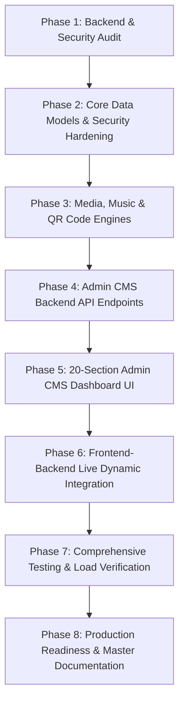

# Aditi & Nitin Royal Wedding - Master Implementation Plan (Phases 2–20)

**Project:** Aditi & Nitin Royal Indian Hindu Wedding Platform & Admin CMS  
**Date:** November 2026  
**Target Completion:** Production-Ready Full-Stack System  

---

## 1. Roadmap & Architecture Overview

---

## 2. Phase-by-Phase Execution Breakdown

### Phase 2: Core Data Models & Security Hardening
- **Dependencies:** Install `multer`, `qrcode`, `sharp`, `@types/multer`, `@types/qrcode`.
- **Database Models (`backend/src/models/`):**
  - `MediaAsset.ts`: Storage path, WebP URL, thumbnail URL, MIME type, dimensions, category, section placement, focal point, alt text.
  - `MusicTrack.ts`: Track URL, title, artist, duration, default track flag, loop, volume, active status.
  - `QRCode.ts`: Type (Invitation, Venue, RSVP, WhatsApp), destination URL, PNG data URL, SVG string, scan count, verified status.
  - `ActivityLog.ts`: Admin ID, email, action type, entity name, entity ID, details, IP address, user-agent.
  - Enhance `Admin.ts`: Roles (`SUPER_ADMIN`, `CONTENT_MANAGER`, `MEDIA_MANAGER`, `RSVP_MANAGER`), `failedAttempts`, `lockUntil`, `lastLoginAt`.
  - Enhance `Wedding.ts`: Correct seed date to **11 December 2026** (`2026-12-11T19:00:00+05:30`), Hero slides, couple bios, love story milestones, family tree, appearance theme, SEO tags.
- **Middleware Hardening (`backend/src/middleware/`):**
  - Implement `requireRole(...roles: string[])` in `auth.ts`.
  - Fix `authController.ts` by removing hardcoded fallback credentials.
  - Implement upload pipeline (`upload.ts`) with MIME type validation, file size limits (10MB image, 15MB audio), and randomized filenames.
  - Harden `errorHandler.ts` to sanitize 500 error responses in production.

### Phase 3: Media, Music & QR Code Engines
- **Media Engine (`backend/src/controllers/mediaController.ts`):**
  - Multipart upload handler converting incoming images to optimized `.webp` via Sharp, generating 300px thumbnails, and saving to `public/uploads/media/`.
  - Section placement binder: assign media to Welcome Ganesha, Hero Slider, Our Story, Haldi, Mehndi, Tilak, Wedding, or Gallery.
- **Music Engine (`backend/src/controllers/musicController.ts`):**
  - Audio upload handler (`.mp3`, `.m4a`, `.aac`, `.ogg`) saving to `public/uploads/music/`.
  - Set default active track, volume control, and metadata updater.
- **QR Code Engine (`backend/src/controllers/qrController.ts`):**
  - Generate real scannable QR codes using `qrcode` for:
    1. Wedding Invitation URL (`https://aditinitinwedding.com/`)
    2. Google Maps Venue Location (`https://maps.google.com/?q=002E+Bank+Colony,+Padari+Bazaar,+Gorakhpur`)
    3. RSVP Page (`https://aditinitinwedding.com/#rsvp`)
    4. WhatsApp Wedding Helpline (`https://wa.me/919876543210?text=Namaste!%20I%20have%20a%20query%20regarding%20Aditi%20%26%20Nitin's%20wedding`)
  - Verification endpoint validating that generated QR codes decode to their target URLs.

### Phase 4: Admin CMS Backend APIs
- **Content Controller (`contentController.ts`):** CRUD for Hero slides, couple details, family details, venue details, appearance colors, and SEO tags.
- **RSVP Controller Enhancement (`rsvpController.ts`):** CSV export (`/api/admin/guests/export`), manual guest creation, status updating.
- **Admin User Management (`adminUserController.ts`):** Super-Admin CRUD for managing administrator accounts and role assignment.
- **Database Backup & Restore (`backupController.ts`):** Full JSON database export and schema validation on restore.
- **Activity Log Controller (`activityLogController.ts`):** Fetch and filter system audit trail.

### Phase 5: 20-Section Admin CMS Dashboard UI (`frontend/src/pages/AdminDashboard.tsx`)
- Build a responsive Royal Gold & Burgundy Admin CMS featuring 20 dedicated sections:
  1. **Dashboard Overview** (Live RSVP metrics, confirmed/declined/pending, media count, music count, recent activity)
  2. **Website Content** (Headline, invitation messages, welcome screen text)
  3. **Hero Slider** (Slide list, titles, subtitles, reordering, desktop/mobile images)
  4. **Couple Details** (Aditi & Nitin bios, photos, lineages)
  5. **Family Details** (Smt. Meera Devi & Shri KBL Srivastava; Smt. Suman & Shri Lalit Mohan Joshi)
  6. **Wedding Events** (Haldi, Mehndi, Tilak, Wedding: timings, venues, dress codes, publish toggles)
  7. **Images & Media Library** (Drag-and-drop upload, categorization, section placement, focal point, deletion)
  8. **Gallery Management** (Add photos, category filters, reordering, lightbox preview)
  9. **Background Music** (Upload tracks, play/pause preview, set default track, volume slider)
  10. **Venue & Location** (Gorakhpur address, Google Maps link, GPS coordinates, arrival directions)
  11. **QR Code Management** (Generate, preview, test decode, download PNG/SVG for Invite, Maps, RSVP, WhatsApp)
  12. **RSVP Management** (Filter confirmed/declined, search, guest counts, dietary notes, manual edit, CSV export)
  13. **Website Appearance** (Burgundy & Gold color palette, typography controls, animation particle toggles)
  14. **SEO Settings** (Meta title, meta description, OG image, keywords, favicon)
  15. **WhatsApp Settings** (Helpline phone numbers, pre-filled messages, template triggers)
  16. **Admin Users & Roles** (List admins, invite/create admin, assign roles: Super Admin, Content, Media, RSVP)
  17. **Activity Logs** (Chronological audit log with filter by action and admin)
  18. **Security Settings** (Change password, session status, lockout policies)
  19. **Backup & Restore** (One-click JSON database download, file restore uploader)
  20. **Website Settings** (Countdown target date override: 11 Dec 2026, maintenance mode toggle)

### Phase 6: Frontend-Backend Integration
- Update `frontend/src/services/api.ts` with typed methods for all public and admin endpoints.
- Update public sections to consume dynamic data with seamless fallback to static defaults:
  - `HeroSlider.tsx`: Dynamic slides.
  - `InvitationSection.tsx`: Dynamic headline, invitation text, and Ganesha artwork.
  - `CoupleSection.tsx` & `OurStory.tsx`: Dynamic bios and milestone photos.
  - `EventsSection.tsx`: Dynamic ceremony timings, dress codes, and locations.
  - `FamilySection.tsx`: Dynamic family blessings and lineage details.
  - `GallerySection.tsx`: Dynamic gallery images.
  - `VenueSection.tsx`: Dynamic address and coordinates.
  - `MusicPlayer.tsx`: Dynamic audio stream from backend active track.

### Phase 7: Comprehensive Testing & Verification
- **Unit & Integration Tests:** Vitest test suites for auth, RBAC, RSVP de-duplication, media uploads, and QR generation.
- **Frontend Tests:** Admin navigation, modal interactions, responsive countdown.
- **Security Tests:** Vulnerability verification against checklist items.
- **Load Testing:** Script simulating 10, 25, and 50 virtual users.

### Phase 8: Deliverables & Final Reports
Generate all remaining reports in `docs/`:
- `docs/SECURITY_TEST_REPORT.md`
- `docs/FRONTEND_TEST_REPORT.md`
- `docs/BACKEND_TEST_REPORT.md`
- `docs/API_TEST_REPORT.md`
- `docs/LOAD_TEST_REPORT.md`
- `docs/DEPLOYMENT_GUIDE.md`
- `docs/ADMIN_USER_GUIDE.md`
- `docs/FINAL_IMPLEMENTATION_REPORT.md`
