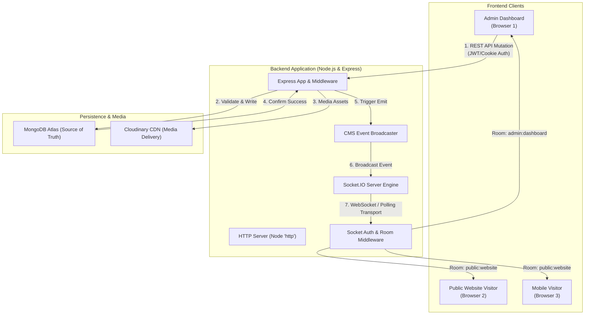

# Socket.IO Real-Time CMS Architecture
**Project:** Aditi & Nitin Royal Wedding Invitation Website  
**Date:** November 22, 2026  
**Status:** ARCHITECTURE DESIGN & SPECIFICATION  

---

## 1. Overview & Objectives
The goal of the Socket.IO Real-Time CMS architecture is to provide sub-second, bi-directional, event-driven data synchronization between the Admin CMS Dashboard and all connected public wedding visitors.

Whenever an authorized administrator creates, updates, reorders, publishes, or deletes content, the backend commits the transaction to the database (MongoDB Atlas) first, and then immediately broadcasts a sanitized, validated real-time payload via Socket.IO to connected clients. Public visitor interfaces update automatically without requiring manual browser refreshes.

---

## 2. Server Architecture & Network Topology



---

## 3. Room Management & Security Policy

### 3.1 Rooms
1. **`public:website`**:
   - Subscribed to by all connected public wedding visitors.
   - Receives events only for **published**, sanitized public website data.
   - Never receives draft content, unpublished photos, or administrative activity logs.
2. **`admin:dashboard`**:
   - Subscribed to exclusively by authenticated administrators.
   - Enforced via JWT cookie / handshake authentication.
   - Receives administrative events, RSVP notifications, activity logs, and real-time dashboard counter updates.

### 3.2 Authentication & Authorization Middleware
- Handshake inspection verifies `aditi_nitin_admin_jwt` HTTP-only cookie or `auth.token`.
- Unauthenticated sockets are granted access only to the `public:website` room.
- Protected rooms (`admin:dashboard`) reject unverified socket connections with an authorization error.
- Sensitive credentials, API keys, and private guest details are strictly omitted from socket payloads.

---

## 4. Standardized Event Naming & Payload Conventions

All events follow the namespaced format: `cms:<entity>:<action>`.

### 4.1 Event Catalog
| Event Name | Room | Description |
| :--- | :--- | :--- |
| `cms:content:updated` | `public:website` & `admin:dashboard` | General wedding details (couple, blessing, date, venue) |
| `cms:hero:updated` | `public:website` & `admin:dashboard` | Hero slider images, captions, or typography |
| `cms:couple:updated` | `public:website` & `admin:dashboard` | Bride and groom profiles, bios, or portraits |
| `cms:family:updated` | `public:website` & `admin:dashboard` | Family member cards or relationship descriptions |
| `cms:story:updated` | `public:website` & `admin:dashboard` | Our Story milestones, images, quotes, or chapters |
| `cms:event:created` | `public:website` & `admin:dashboard` | New wedding ceremony created |
| `cms:event:updated` | `public:website` & `admin:dashboard` | Ceremony details, image, or timing updated |
| `cms:event:deleted` | `public:website` & `admin:dashboard` | Ceremony removed |
| `cms:event:reordered` | `public:website` & `admin:dashboard` | Order of wedding ceremonies changed |
| `cms:gallery:created` | `public:website` & `admin:dashboard` | New gallery photo added |
| `cms:gallery:updated` | `public:website` & `admin:dashboard` | Photo caption, category, or published status updated |
| `cms:gallery:deleted` | `public:website` & `admin:dashboard` | Photo removed |
| `cms:gallery:reordered` | `public:website` & `admin:dashboard` | Gallery layout reordered |
| `cms:music:updated` | `public:website` & `admin:dashboard` | Background music track, playlist, or volume updated |
| `cms:venue:updated` | `public:website` & `admin:dashboard` | Venue name, address, or map links updated |
| `cms:appearance:updated` | `public:website` & `admin:dashboard` | Theme colors, flower petals, or floating particles |
| `admin:rsvp:received` | `admin:dashboard` (Protected) | New guest RSVP received |

### 4.2 Standard Payload Schema
```typescript
interface RealtimeCmsPayload<T = any> {
  entity: 'wedding' | 'event' | 'gallery' | 'story' | 'music' | 'media' | 'appearance';
  action: 'create' | 'update' | 'delete' | 'reorder' | 'publish';
  id?: string;
  data?: T;
  timestamp: number;
}
```

---

## 5. Resilient Connection Lifecycle & Fallback
- **Primary Transport:** WebSockets (`ws://` / `wss://`), upgrading from long-polling.
- **Reconnection Logic:** Auto-reconnect with exponential backoff (1s, 2s, 5s, 10s max delay).
- **Offline / Disconnect Resilience:** Public website functions normally via cached data and standard REST APIs if the socket connection is unavailable.
- **Cross-Tab Fallback:** Complements existing `BroadcastChannel` and `localStorage` synchronization for zero-latency local tab communication.
